# DeepEMD

<p align="center">
  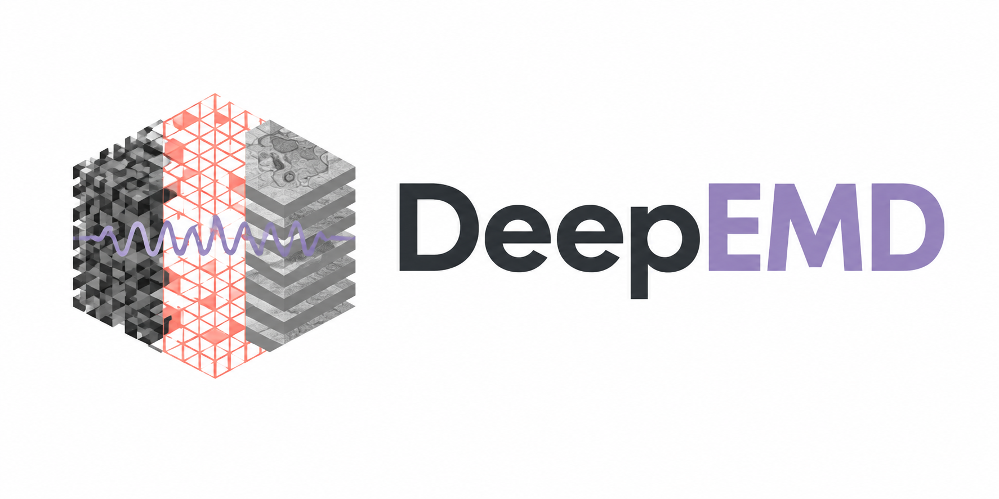
</p>

**1. DeepEMD supports accelerated volume electron microscopy through self-supervised denoising.**

<table>
  <tr>
    <td width="34%" align="center">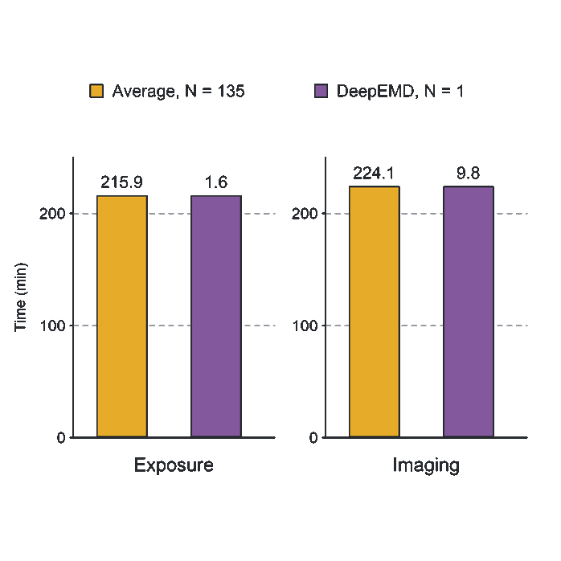</td>
    <td width="33%" align="center">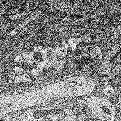</td>
    <td width="33%" align="center">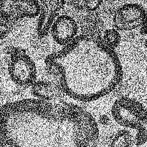</td>
  </tr>
</table>

**2. DeepEMD denoising supports organelle segmentation in volume electron microscopy images.**

<table>
  <tr>
    <td width="25%" align="center">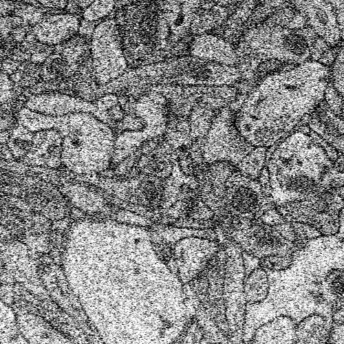</td>
    <td width="25%" align="center">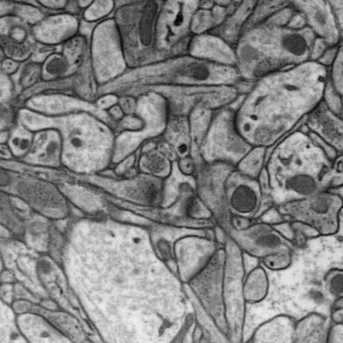</td>
    <td width="25%" align="center">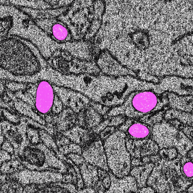</td>
    <td width="25%" align="center">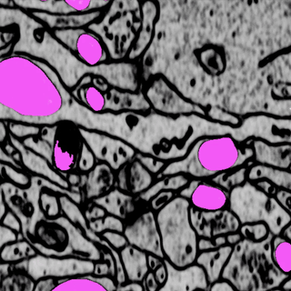</td>
  </tr>
</table>

**3. DeepEMD denoising supports rapid connectome reconstruction from volume electron microscopy images.**

<table>
  <tr>
    <td width="50%" align="center">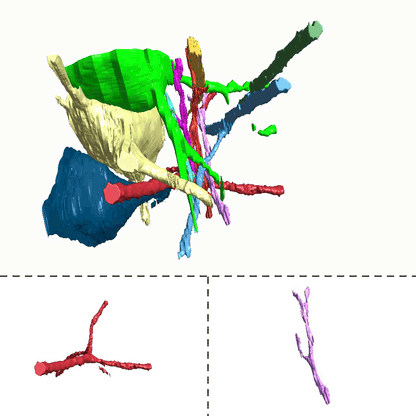</td>
    <td width="50%" align="center">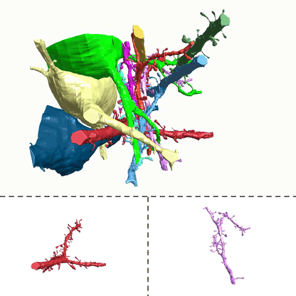</td>
  </tr>
</table>

**4. DeepEMD denoising supports the search for rare ultrastructural features in volume electron microscopy images.**

<table>
  <tr>
    <td width="61%" align="center">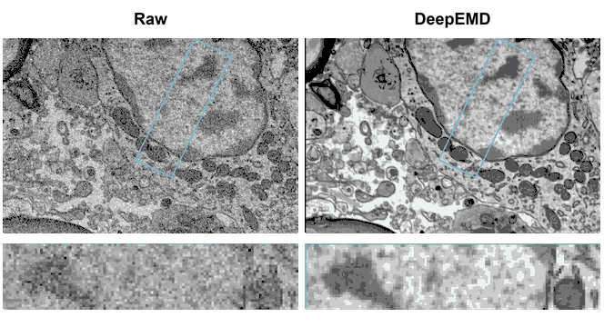</td>
    <td width="39%" align="center">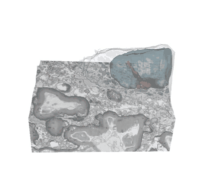</td>
  </tr>
</table>

## Contents

- [Overview](#overview)
- [Repository structure](#repository-structure)
- [Installation](#installation)
- [Quick start](#quick-start)
- [Datasets](#datasets)
- [Results](#results)

## Overview

## Repository structure

<details>

<summary>Click to unfold the directory tree</summary>

```text
DeepEMD/
├── run_deepemd.py            # Training and denoising entry point
├── visualize_deepemd.py      # Visualization entry point
├── requirements.txt         # Dependencies
├── requirements-runtime.txt # Runtime dependencies
├── config/                  # Bernoulli and INR configurations
├── deepemd/
│   ├── data/                 # Dataset download links and documentation
│   ├── runner.py            # Run orchestration
│   ├── engine.py            # Denoising engine
│   ├── inr_engine.py        # INR denoising engine
│   ├── visualization.py     # Result visualization
│   ├── models/              # Network architectures
│   └── utils/               # Shared utilities
├── scripts/                 # Environment setup, checks, and packaging
├── tests/                   # Regression tests
└── assets/                 # Logo and README showcase images
```

</details>

## Installation

### 1. Environment setup

The following commands are intended for Linux servers with NVIDIA GPUs. Make sure Miniconda/Anaconda is installed, then enter the DeepEMD project directory.

For the first run, create and activate the environment:

```bash
bash scripts/setup_deepemd_env.sh
source scripts/activate_deepemd_env.sh
```

By default, the scripts create a Python 3.10 environment named `.venv_py310` inside the project, install dependencies, and check CUDA. When opening a new terminal later, enter the project directory and activate the environment:

```bash
source scripts/activate_deepemd_env.sh
```

## Quick start

### 2. Select a configuration and run

The `config/` directory contains selected configurations.

```bash
python run_deepemd.py \
  --input /data/volume.tif \
  --config deepemd.yml \
  --output results/volume_output \
  --gpu 5
```

If `--config` is omitted, this configuration is used by default.

Replace `--input` with the actual TIFF path, use `--output` to specify the results directory, and set `--gpu` to the ID of a single GPU. Use separate results directories for different inputs or configurations.

### 3. View results

After the run finishes, check the specified `--output` directory:

- `denoised_tiff/denoised.tif`: the denoised volume.
- `comparison.pdf`: a comparison of the input and denoised images, showing the first, middle, and last slices with zoomed-in regions by default.
- `logs/<config-name>.log`: training and denoising progress.

For adjustable parameters such as tile size, slice window, and masking, see:

```bash
python run_deepemd.py --help
```

## Datasets

Dataset download links are listed below. Click the DOI links in the Sample column to access each dataset.

| No. | Sample | Events | Voxel size | Imaging depth | Data size | Comments |
| --- | --- | --- | --- | --- | --- | --- |
| 1 | Mouse brain<br>[](https://doi.org/10.5281/zenodo.23390631) | Subcellular structures | 10×10×50 nm/pxl | 0-8.3 μm | 3.98 GB | Low-SNR/GT |
| 2 | Mouse brain<br>[](https://doi.org/10.5281/zenodo.23390641) | Subcellular structures | 10×10×50 nm/pxl | 0-9.2 μm | 0.26 GB | Low-SNR/high-SNR |
| 3 | Rat visual cortex<br>[](https://doi.org/10.5281/zenodo.23390645) | Mitochondria segmentation | 8×8×30 nm/pxl | 0-3 μm | 3.36 GB | Low-SNR |
| 4 | Mouse brain<br>[](https://doi.org/10.5281/zenodo.23390657) | Connectomic | 10×10×10 nm/pxl | 0-15.2 μm | 8.25 GB | Low-SNR |
| 5 | Human glioma<br>[](https://doi.org/10.5281/zenodo.23877351) | Mitochondrial configuration | 10×10×10 nm/pxl | 0-13.9 μm | 0.95 GB | Low-SNR |
| 6 | Human glioma<br>[](https://doi.org/10.5281/zenodo.23390661) | Demyelination | 10×10×10 nm/pxl | 0-16.1 μm | 10.89 GB | Low-SNR |

## Results

### 1. DeepEMD restores fine ultrastructures in FIB–SEM across various noise levels.

<p align="center">
  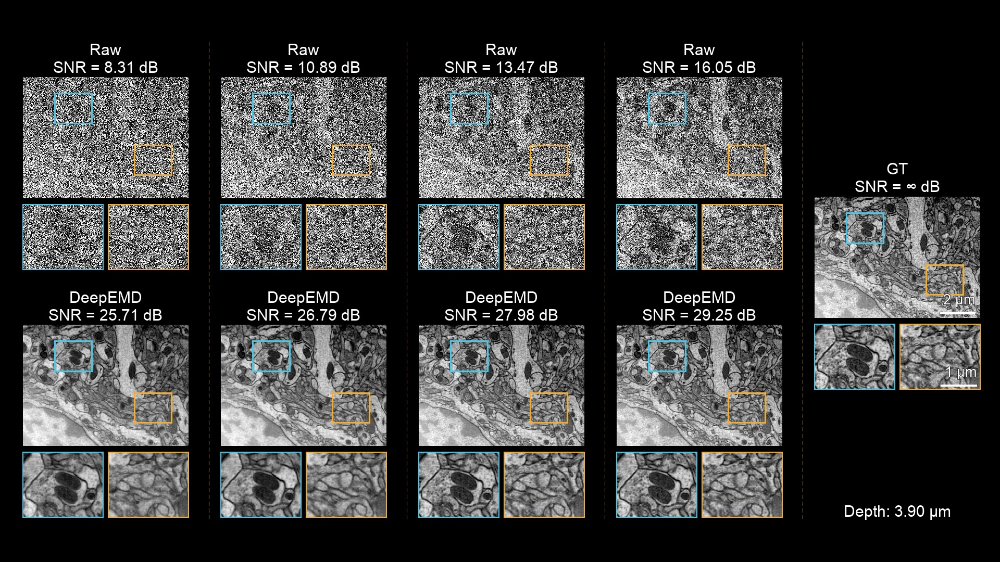
</p>

### 2. DeepEMD enables high-fidelity volume EM with a 135-fold reduction in exposure time and a 22.8-fold reduction in imaging time.

<p align="center">
  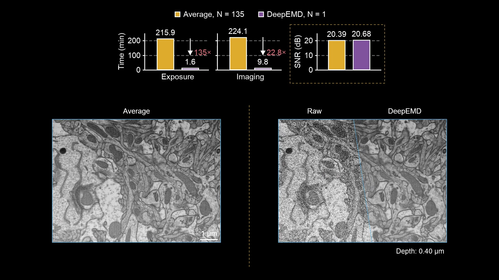
</p>

### 3. DeepEMD facilitates mitochondrial segmentation in low-SNR EM volumes and enables improved 3D reconstruction.

<p align="center">
  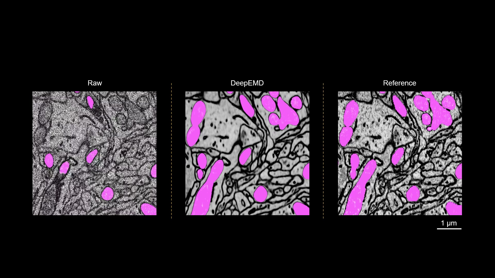
</p>

### 4. EM volumes of brain tissue before and after DeepEMD denoising.

<p align="center">
  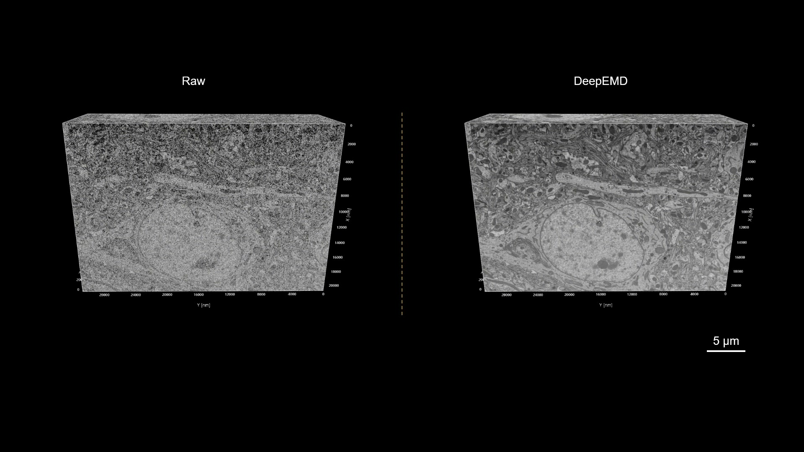
</p>

### 5. DeepEMD enables connectomic construction with more complete dendritic morphology.

<p align="center">
  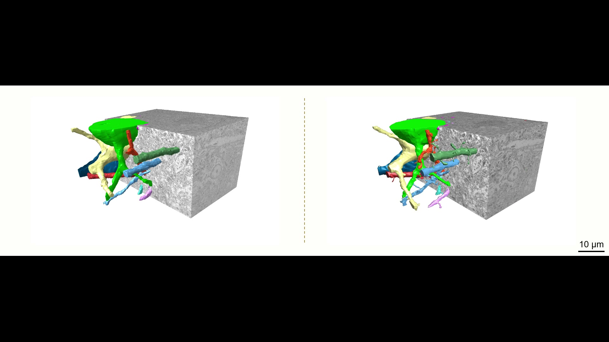
</p>

### 6. DeepEMD reveals pronounced intratumoral demyelination.

<p align="center">
  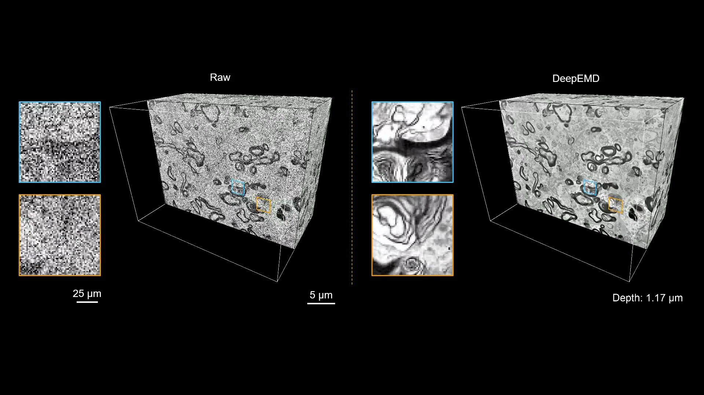
</p>

### 7. DeepEMD reveals clear membrane structures for large-scale volume EM screening of human glioma tissue.

<p align="center">
  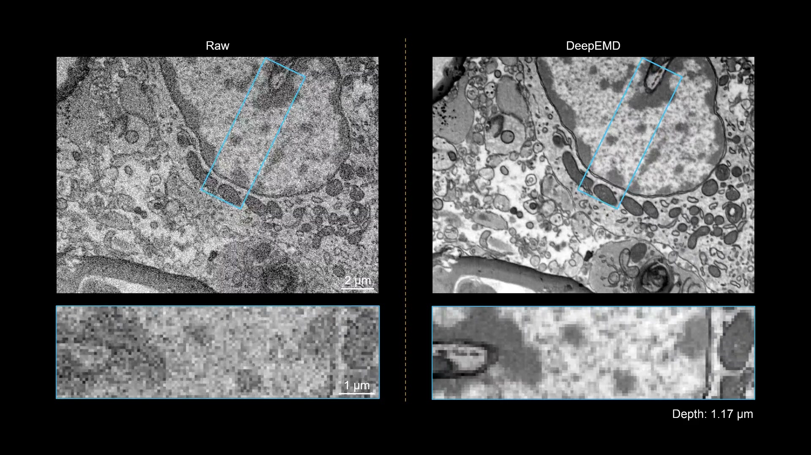
</p>

### 8. 3D visualization of a rare ultrastructural candidate: a mitochondrion appears to traverse the nucleus through a cytoplasmic channel bounded by continuous nuclear membranes.

<p align="center">
  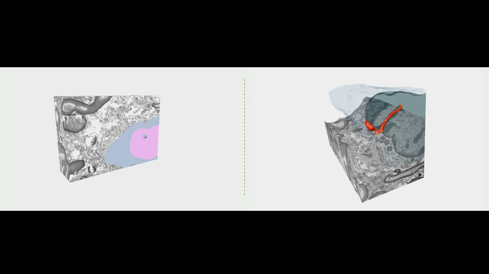
</p>
